<p align="center">
  
</p>

<h1 align="center">WatchTwitch</h1>

<p align="center">
  Collects Twitch Drops for you — leave it running overnight and wake up to claimed rewards.
</p>

<p align="center">
  <a href="https://github.com/Agrysif/WatchTwitch/releases/latest"><b>Download for Windows</b></a>
  ·
  <a href="README.ru.md">Русская версия</a>
</p>

<p align="center">
  <a href="https://github.com/Agrysif/WatchTwitch/releases/download/v1.2.0/WatchTwitch-trailer.mp4">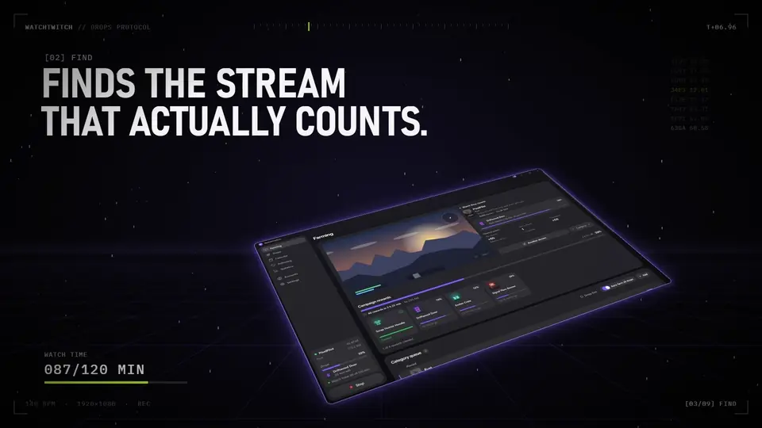</a>
</p>

<p align="center">
  <a href="https://github.com/Agrysif/WatchTwitch/releases/download/v1.2.0/WatchTwitch-trailer.mp4"><b>▶ Watch the trailer</b></a> · 32 seconds, 1080p
</p>

## What it does

You pick the games. WatchTwitch finds a live stream where the drop campaign actually counts, watches it in the background at 160p, claims rewards as soon as Twitch hands them out, and moves on to the next game when the current one is done.

<p align="center">
  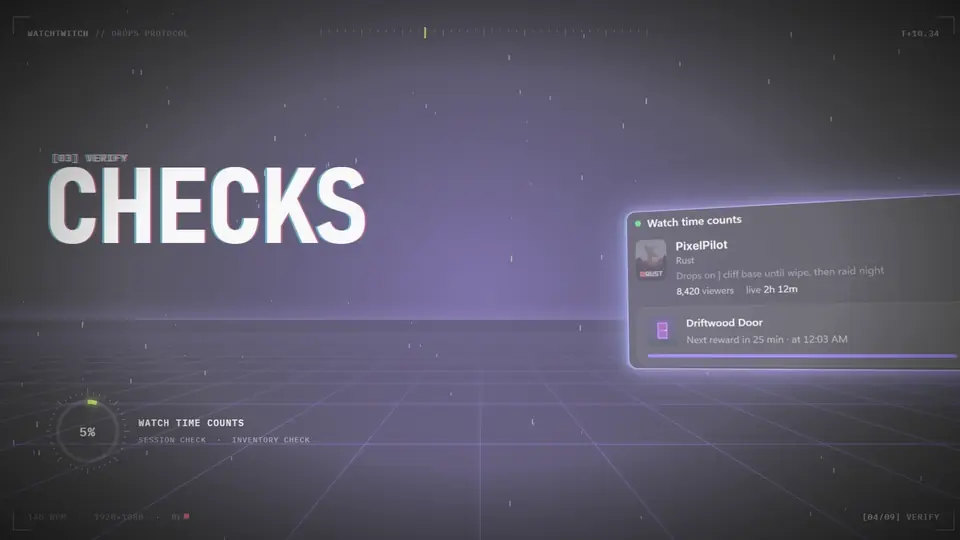
</p>

- **Hands-free farming.** A queue of categories that you can sort by drag and drop, or let the app order by value: it skips campaigns you can't finish in time and goes where an hour of watching earns the most.
- **Checks that watch time really counts.** If Twitch doesn't credit a channel, the app switches to another one. If no channel in a game counts, it puts the game on hold and moves on.
- **Switches streams by itself** when a broadcast ends, the streamer changes games, or every reward is collected.
- **Claims rewards and bonus chests automatically**, so channel points add up too.
- **Drops page** with every campaign, progress per reward and a “Claim all” button.
- **Calendar** of campaigns: what ends today, what starts this week, and rewards you missed.
- **Following page** with live status and favorites. Favorite channels go first when they stream a game from your queue.
- **Statistics**: watch time, rewards, points, chests, rewards per hour, CSV export.
- **Stays out of the way.** Game mode drops the stream to a lower speed while you play so your ping stays steady. You also get quiet hours, a light graphics mode and a mini player in the sidebar.
- **Runs unattended.** It minimizes to the tray, starts with Windows and picks the session back up after a restart. It can also shut down or sleep the PC when farming is done.
- **Notifications** for claimed rewards, favorite streamers going live and anything that needs your attention.
- **English and Russian**, dark and light themes, iOS 27 glass style or Classic.
- **Automatic updates.**

## How it works

<p align="center">
  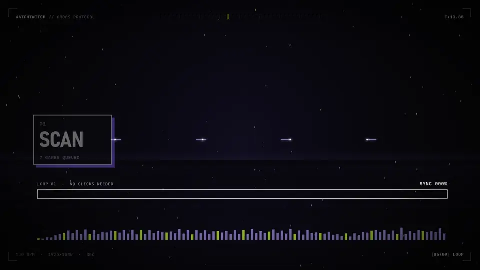
</p>

1. **Scan.** Takes the next game from your queue that has a running campaign and finds a live channel where it counts.
2. **Verify.** Makes sure Twitch actually credits the watch time. If it doesn't, the app tries another channel.
3. **Watch.** Plays the stream in the background at 160p, quietly and with little traffic.
4. **Claim.** Claims every reward and bonus chest the moment it's ready.
5. **Next.** When the stream ends or the game is done, it moves on to the next one — all night long.

## Screenshots

<p align="center">
  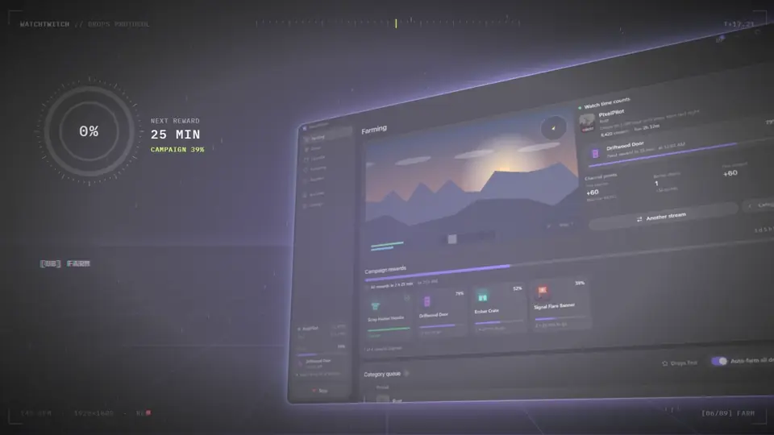
</p>

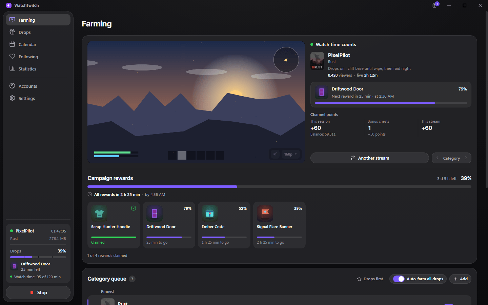

| Drops | Calendar |
| --- | --- |
| 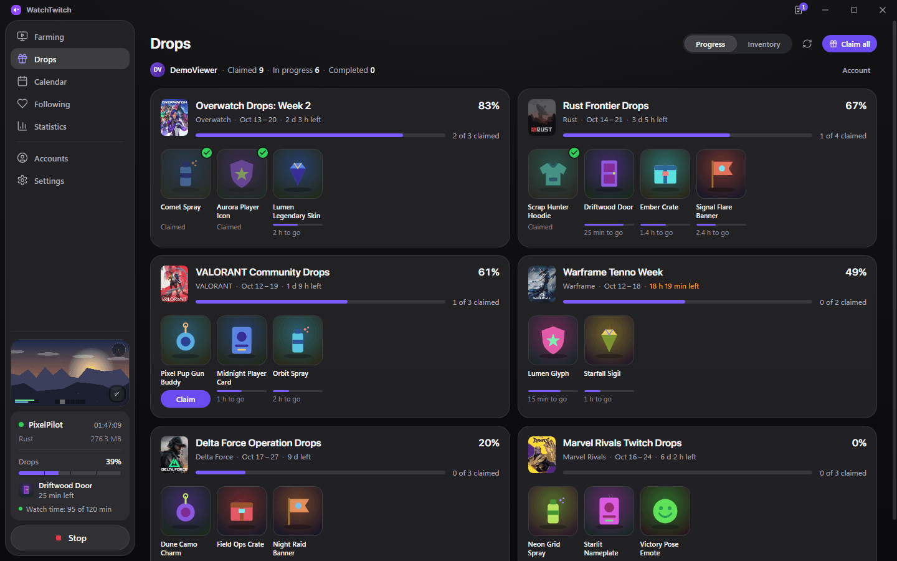 | 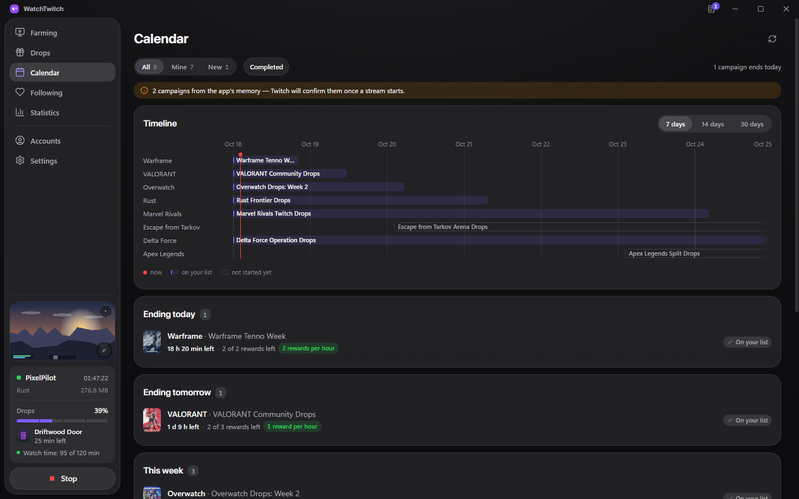 |
| **Following** | **Statistics** |
| 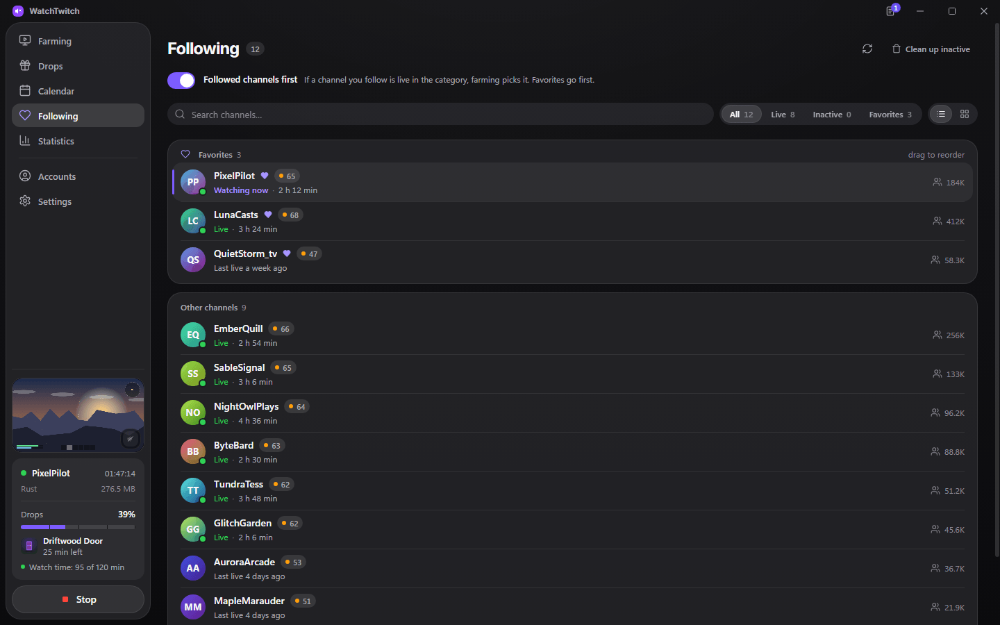 | 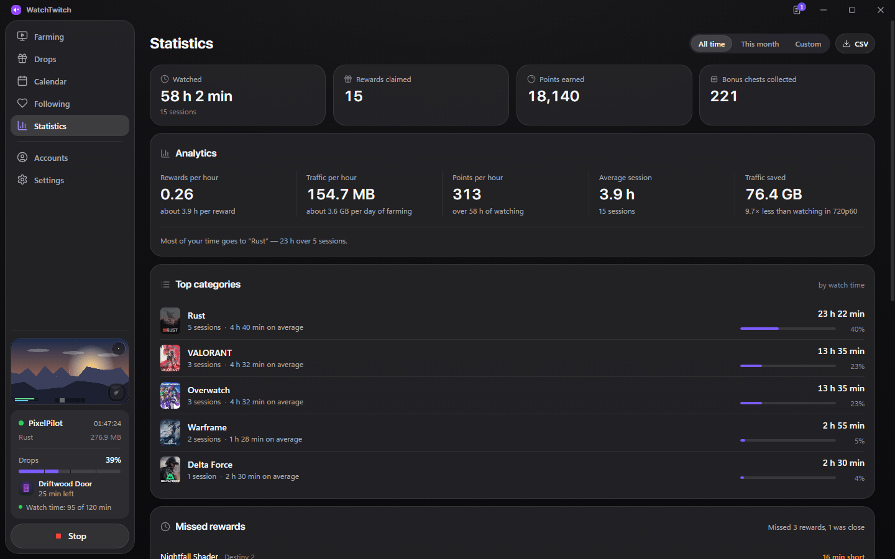 |
| **Light theme** | **Classic style** |
| 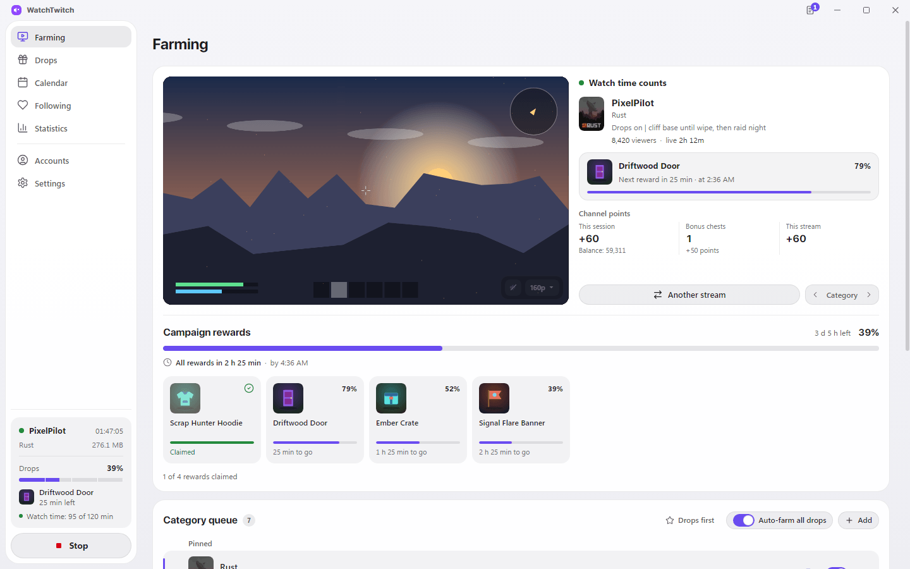 | 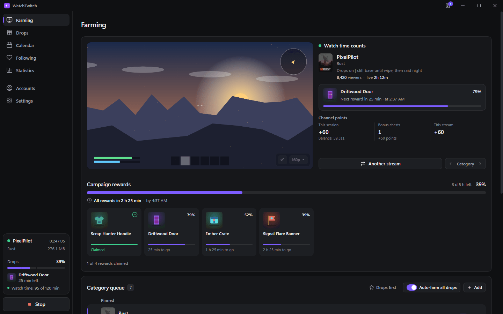 |

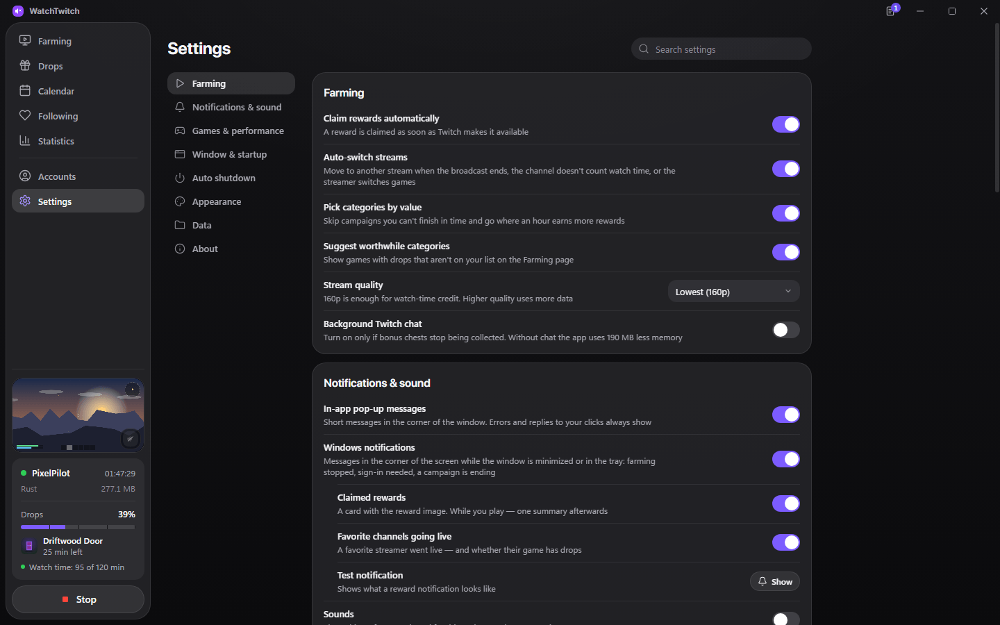

<sub>Screenshots use demo data: the account and channel names are made up.</sub>

## Getting started

1. Download `WatchTwitch-Setup-x.y.z.exe` from the [latest release](https://github.com/Agrysif/WatchTwitch/releases/latest) and run it. Windows 10 or 11, 64-bit.
2. Open **Accounts** and sign in with your Twitch account.
3. On **Farming**, add the games you want drops for, or turn on **Auto-farm all drops**.
4. Press **Start farming**. That's it — the app keeps going on its own.

Linking your game account on the campaign's page on Twitch is still up to you: rewards for unlinked games can't be claimed.

## Privacy

- Your sign-in stays on your computer, encrypted with Windows' built-in protection.
- The app talks only to Twitch and to GitHub for updates. No analytics, no third-party servers.
- Streams play through the official Twitch player.

## FAQ

**Will it use a lot of traffic?** At 160p a stream takes roughly 100–200 MB per hour, depending on the channel. The statistics page shows how much was actually used.

**Can I play while it farms?** Yes. Game mode recognizes Overwatch, CS2, VALORANT, Dota 2 and dozens of other games, and you can add your own `.exe`.

**How do I switch the language?** Settings → Appearance → Language. The new language applies after a restart. A new install picks English or Russian from your Windows language.

## Building from source

```bash
npm install
npm start          # run the app
npm test           # unit and regression tests
npm run build:win  # installer in dist/
```

Built with Electron. The release process (in Russian) is described in [RELEASE.md](RELEASE.md).

## License

MIT · Made by Agrysif (Egor Balashov) for the Twitch community.

WatchTwitch is not affiliated with Twitch Interactive, Inc.
